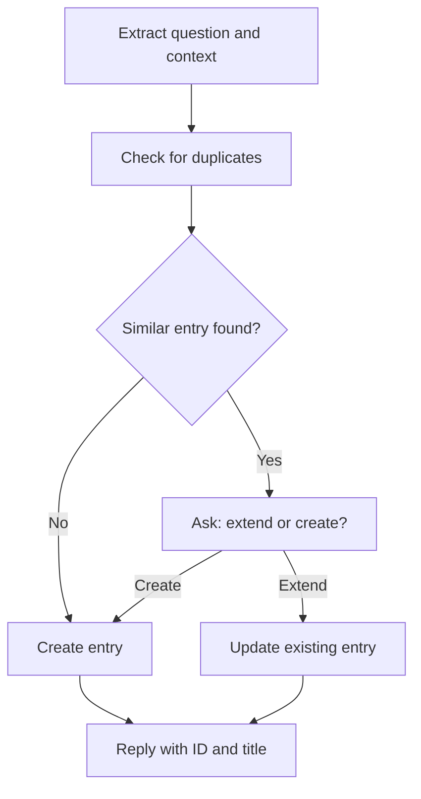

# Learning Backlog

Save questions for later study. Each entry must make sense without the original
dialogue. Return to saved topics when the user asks.

## Use the CLI

Requires Python 3.10 or later. Run all entry operations through the CLI.
Do not create, edit, or delete stored entries by hand.

In the examples, replace `<skill-dir>` with this skill's directory.

```sh
python3 <skill-dir>/scripts/learning_backlog.py <command> ...
```

### Storage

- One topic occupies one `LB-NNNN.md` file.
- Files are the source of truth. There is no index.
- The data directory is separate from the skill directory.

Directory selection, from highest to lowest priority:

1. Global `--dir`, placed before the command.
2. `LEARNING_BACKLOG_DIR` environment variable.
3. Default: `~/.local/share/learning-backlog`.

```sh
python3 <skill-dir>/scripts/learning_backlog.py --dir /tmp/study-topics list
```

### Commands

| Command | Result |
| --- | --- |
| `add --title TITLE` | Create an open entry; assign its ID and timestamps |
| `list` | List open entries by default |
| `show ID` | Print the full entry |
| `update ID` | Change metadata or a section |
| `set-status ID STATUS` | Set `open`, `learned`, or `archived` |
| `export ID...` | Export selected entries as Markdown |
| `template` | Print the entry template |
| `dir` | Print the data directory |

Accepted ID forms: `LB-0012`, `LB-12`, or `12`.
Use `<command> --help` for the full argument list.

### Exit codes

| Code | Meaning | Agent action |
| --- | --- | --- |
| `0` | Success | Report the result |
| `1` | Data, validation, or filesystem error | Show the CLI error |
| `2` | Invalid command or arguments | Check `--help` and correct the invocation |

Do not bypass errors by editing stored files. With `list`, code `1` can accompany
partial output: valid entries are printed, invalid files are reported on stderr.
Do not present that output as a complete list.

## Entry format

Read [the entry template](assets/entry-template.md) for the stored format.
The CLI generates frontmatter and the `#` title. Pass only `##` sections to
`add`, through stdin or `--body-file`.

| Section | Content | If empty or omitted |
| --- | --- | --- |
| `What I want to understand` | A specific question or gap in understanding | Error |
| `Context` | The task and where the question arose | `Not recorded.` |
| `Example` | Code, an error, or a sequence of actions | `Not recorded.` |
| `Decision and alternatives` | The choice, reasons, and options discussed | `Not recorded.` |

- Keep these section names exactly as shown.
- Extra sections follow the four standard sections.
- Use `###` or deeper headings inside a section.
- Put unconfirmed ideas in `Agent assumptions`.
- Put agreed study conclusions in `Analysis results`.

## Record evidence accurately

- Use facts from the session, code, or command output.
- Do not invent reasons, alternatives, references, or explanations.
- Preserve the user's wording in `What I want to understand`:

  ```markdown
  > Original wording: "<the user's question>"
  ```

- Do not answer the question while saving it.
- Include a self-contained example, usually no more than 20 lines.
- References support the example; they do not replace it.
- Add known source details to `Example`:

  ```text
  Source: <path>, symbol <Name.symbol>, commit <short hash>.
  ```

For committed code, obtain the hash with `git rev-parse --short HEAD`.
Omit source details that are unknown.

## Save a topic



1. Extract the question and context from the session.
   Ask one question only if the subject is unclear. Do not use a questionnaire.
2. Choose a title that makes sense outside the project.
   Example: `Why asyncio.shield wraps commit in a cancellation handler`.
3. Select metadata:
   - Project: the repository basename from `git rev-parse --show-toplevel`,
     unless the user names another project.
   - Tags: 1-4 short lowercase terms, such as `python` or `asyncio`.
4. Check for semantic duplicates:

   ```sh
   python3 <skill-dir>/scripts/learning_backlog.py list --status all --format json
   ```

   Compare `title` and `question`. For a large catalog, narrow the search with
   `--project`, `--tag`, or `--query`.
   If a similar entry exists, ask whether to extend it or create a new entry.
   Wait for the choice. Do not merge entries automatically.
5. Create the entry. Replace the sample question with the user's question.

   ```sh
   python3 <skill-dir>/scripts/learning_backlog.py add \
     --title "Why asyncio.shield wraps commit" \
     --project finsight --tag python --tag asyncio <<'EOF'
   ## What I want to understand
   What happens if cancellation arrives while a shielded commit is running?
   EOF
   ```

   Add the other sections when the session provides their content.
   The CLI fills omitted sections with `Not recorded.`.
6. Check that the command exits with `0`. Reply with the ID and title on one line.
   Do not repeat the entry body.

## Find topics

Run `list` with the requested filters. Present the result compactly.
Use `--status all` for learned or archived topics, or when checking duplicates.

```sh
python3 <skill-dir>/scripts/learning_backlog.py list --project finsight --tag python
python3 <skill-dir>/scripts/learning_backlog.py list --query shield --format json
```

| Filter | Behavior |
| --- | --- |
| `--status` | `open` by default; also accepts `learned`, `archived`, or `all` |
| `--project` | Exact project match, ignoring case |
| Repeated `--tag` | Every specified tag must match |
| `--query` | Substring in the title or section text, ignoring case |
| `--format json` | Structured output with `title` and `question` |

## Work through a topic

1. Open the entry with `show ID`.
2. Briefly recall its question and context. Start with the original question.
3. If the example refers to the current repository, compare it with current code.
   Explain any differences.
4. Suggest `teach-through-dialogue` if the user wants guiding questions.
5. When conclusions emerge, offer to save them. After agreement, append them:

   ```sh
   python3 <skill-dir>/scripts/learning_backlog.py update LB-12 \
     --section "Analysis results" --stamp <<'EOF'
   <Conclusions reached in the dialogue and references actually used.>
   EOF
   ```

Opening or explaining a topic does not change its status.

## Update an entry

Pass section text through stdin or `--body-file`.

```sh
python3 <skill-dir>/scripts/learning_backlog.py update LB-12 \
  --section "Context" <<'EOF'
<Additional context from the session.>
EOF
```

| Option | Effect |
| --- | --- |
| `--section NAME` | Append text by default; create the section if absent |
| `--mode replace` | Replace the section; forbidden for `What I want to understand` |
| `--stamp` | Prefix the new text with a `### YYYY-MM-DD` heading |
| `--title TITLE` | Rename the entry |
| `--project PROJECT` | Set the project |
| `--clear-project` | Remove the project |
| `--add-tag TAG` | Add a tag; repeat for more tags |
| `--remove-tag TAG` | Remove a tag; repeat for more tags |

## Change status

| Status | Required user intent |
| --- | --- |
| `learned` | The user explicitly says the topic is learned |
| `archived` | The user asks to drop the topic without studying it |
| `open` | The user asks to reopen the topic |

Only pass `--user-confirmed` after the user confirms that the topic is learned.
An explanation or the agent's judgment is not confirmation.

```sh
python3 <skill-dir>/scripts/learning_backlog.py set-status LB-12 learned --user-confirmed
```

## Export topics for a study plan

1. Identify the selected IDs from the request or through `list`.
2. Export them:

   ```sh
   python3 <skill-dir>/scripts/learning_backlog.py export LB-12 LB-15
   ```

3. Return the export unchanged.

Export includes questions, context, examples, and saved conclusions.
Do not create a curriculum, study order, or roadmap unless separately requested.
