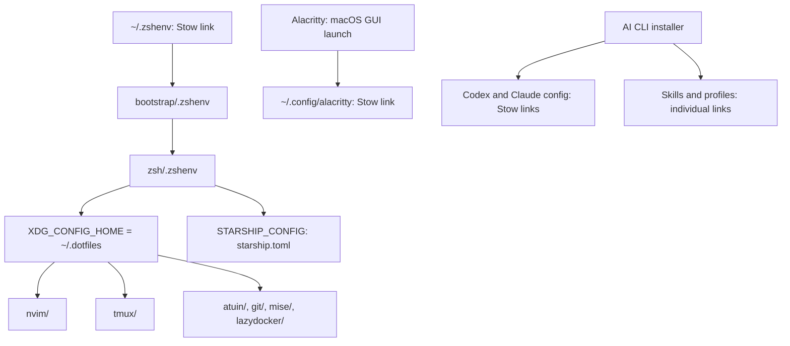

# How configuration is loaded

The shell sets `XDG_CONFIG_HOME=$HOME/.dotfiles` unless it is already set.
Tools that inherit this environment can read configuration from the checkout.
Stow supplies links for tools that need other paths.

## Stow packages

| Package | Destination | Reason |
| --- | --- | --- |
| `bootstrap` | `~/.zshenv` | Zsh needs this file before it can read XDG settings. |
| `alacritty` | `~/.config/alacritty` | A GUI launch may not inherit the shell's environment. |
| `ai-agents` | `~/.claude/`, `~/.codex/` | AI CLI config uses these locations. |

The AI installer manages skill links separately. It also links Codex profiles.
Stow folds the tracked Claude agents directory into `~/.claude/agents/`.

## Shell startup

`bootstrap/.zshenv` sets `ZDOTDIR=$HOME/.dotfiles/zsh` and reads `zsh/.zshenv`.
That file exports XDG paths, `STARSHIP_CONFIG`, `GOPATH`, and editor variables.

`zsh/bootstrap.zsh` creates home-level links for `.zshrc`, `.zprofile`, and
`.zlogin` when the source files exist. These support tools such as Oh My Zsh
that expect a literal `~/.zshrc`.

The `.zshrc` caches initialization for Starship, mise, atuin, and zoxide.
It refreshes each cache when the corresponding executable is newer.

## Launches outside the shell

A GUI launcher may not inherit `XDG_CONFIG_HOME`.

- Neovim may load the default `~/.config/nvim` instead of this checkout.
- A GUI Git client may miss the excludes file at `$XDG_CONFIG_HOME/git/ignore`.
- Alacritty uses a dedicated Stow link for its default config path.

Launch Neovim from a configured terminal or provide the environment explicitly.
See [Neovim startup checks](../../nvim/README.md#verify-config-loading).

## Files that are local only

A fresh clone does not reproduce ignored runtime state:

- CLI authentication under `gh/` and `glab-cli/`;
- local preferences under `homebrew/`, `htop/`, `k9s/`, and `lazygit/`;
- `openspec/config.json`, shell history, caches, and plugin checkouts;
- Codex/Claude credentials, sessions, local settings, and rendered Codex config.

The tracked `docs/` directory holds repository documents. It is not runtime config.
`goose/` has no documented install step.
