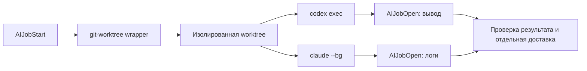

# AI в Neovim

Выберите интерфейс по задаче:

| Интерфейс | Для чего | Клавиши |
| --- | --- | --- |
| CodeCompanion | Чат, inline-правки, библиотека prompts | `<leader>A` |
| claudecode.nvim | Claude CLI, исследования, проверка diff | `<leader>C` |
| Фоновые задачи | Изолированный запуск Codex или Claude в worktree | `<leader>Ar/Aj/Ao/Ax` |

CodeCompanion использует Ollama, рабочий HTTP-прокси или Claude по ACP.
claudecode.nvim использует CLI и его авторизацию, MCP, skills, правила и субагентов.

## Первичная настройка

1. Установите `claude` CLI и войдите в аккаунт для claudecode.nvim.
2. Для профиля CodeCompanion `claude` установите мост ACP:

   ```sh
   npm install -g @zed-industries/claude-code-acp
   ```

3. При необходимости получите `CLAUDE_CODE_OAUTH_TOKEN` через `claude setup-token`.
   Храните токен только в локальном окружении. Не коммитьте его.
   ACP также работает с интерактивной авторизацией подписки.
4. Запустите Neovim и выполните `:AIProfileStatus`.

Оба интерфейса Claude используют подписку. `ANTHROPIC_API_KEY` им не нужен.
Мост в конфигурации называется `claude-code-acp`.

## Профили CodeCompanion

`NVIM_AI_PROFILE` применяется при запуске Neovim:

```sh
NVIM_AI_PROFILE=claude nvim
```

| Значение | Чат | Inline / cmd |
| --- | --- | --- |
| `home`, по умолчанию | Ollama | Ollama |
| `work` | Рабочий HTTP-прокси | Рабочий HTTP-прокси |
| `claude` | `claude_code`, ACP | Ollama |

Для `work` задайте в локальном окружении:

- `NVIM_AI_WORK_URL`;
- `NVIM_AI_WORK_API_KEY`;
- `NVIM_AI_WORK_MODEL`.

ACP используется только для чата. Inline/cmd остаются на HTTP-адаптере.
Claude-чат доступен из любого профиля по `<leader>Al`.
Модель claudecode.nvim выбирается через `<leader>Cm`.

## Клавиши

Регистр важен: `<leader>C` относится к Claude, `<leader>c` занят закрытием буфера.

### CodeCompanion

| Клавиши | Действие |
| --- | --- |
| `<leader>AA` | Палитра действий |
| `<leader>Ac` | Открыть или скрыть чат |
| `<leader>Aq` | Добавить выделение в чат, Visual mode |
| `<leader>Al` | Открыть Claude-чат по ACP |

### claudecode.nvim

| Клавиши | Действие |
| --- | --- |
| `<leader>Cc` | Открыть или скрыть Claude Code |
| `<leader>Cf` | Перейти в окно Claude |
| `<leader>Cr` | Возобновить сессию, `--resume` |
| `<leader>CC` | Продолжить последнюю сессию, `--continue` |
| `<leader>Cb` | Добавить текущий буфер |
| `<leader>Cs` | Отправить выделение, Visual mode |
| `<leader>Ca` / `<leader>Cd` | Принять / отклонить diff |
| `<leader>Cm` | Выбрать модель |
| `<leader>CR` | Подготовить запрос на исследование |
| `<leader>CS` | Показать статус |

### Фоновые задачи

| Клавиши | Команда | Действие |
| --- | --- | --- |
| `<leader>Ar` | `:AIJobStart` | Запустить задачу |
| `<leader>Aj` | `:AIJobList` | Показать список |
| `<leader>Ao` | `:AIJobOpen [job-id]` | Открыть вывод или логи |
| `<leader>Ax` | `:AIJobCancel [job-id]` | Отменить задачу |

## Запустить фоновую задачу

Для анализа:

```vim
:AIJobStart codex read Сравни варианты реализации
```

Для изолированного прототипа:

```vim
:AIJobStart claude write Добавь прототип без коммита
```

Если провайдер, режим или запрос пропущены, Neovim спросит их по очереди.
Completion предлагает провайдеры, режимы и известные ID задач.
`:AIJobList` не принимает аргументы.



Worktree создается от зафиксированного Git-состояния:

```text
stdpath("state")/ai-jobs/worktrees/
```

Провайдер получает эту worktree как `cwd`. Основной checkout ему не передается.

| Провайдер | Режим `read` | Режим `write` | Наблюдение |
| --- | --- | --- | --- |
| Codex | Sandbox `read-only` | `workspace-write`, сеть отключена | Асинхронный `codex exec`, запрос через stdin |
| Claude | Permissions `plan` | Permissions `auto` | `claude --bg`, опрос `claude agents --json --all` |

Neovim хранит список задач в памяти и отслеживает процессы.
Статусы `working`, `blocked`, `done`, `failed`, `stopped` не подтверждают
содержательный успех задачи. Проверьте результат через `<leader>Ao`.

### Закрытие Neovim и восстановление

- Список задач не сохраняется после перезапуска Neovim.
- Codex получает SIGTERM при `VimLeavePre`.
- Claude продолжает работать под собственным supervisor.
- Worktree и ветка остаются для проверки и ручного удаления.

Найти и остановить оставшуюся задачу Claude:

```sh
claude agents
claude stop <id>
```

Оболочка не создает очередь, не разбирает смысл результата и не запускает субагентов.
Она не делает commit, push, PR, merge, обход permissions или автоматический cleanup.
Проверка и доставка изменений выполняются отдельно.

## Prompts CodeCompanion

Библиотека `~/.dotfiles/llm/prompts/` доступна в палитре и через `/alias` в чате.

| Команда | Назначение | Выполнение |
| --- | --- | --- |
| `/explain` | Объяснить выделенный код | chat |
| `/fix` | Исправить код | chat |
| `/lsp` | Объяснить LSP-диагностику | chat |
| `/review` | Найти баги, риски безопасности и производительности | chat, HIGH/MED/LOW |
| `/refactor` | Упростить код с сохранением поведения | inline, diff |
| `/tests` | Создать unit-тесты | inline, новый буфер |
| `/commit` | Подготовить сообщение по staged diff | chat |

Полный список: [библиотека prompts](../llm/README.md).
Контракт: [PROMPT_POLICY.md](../llm/PROMPT_POLICY.md).

## Подготовить исследование

1. Выполните `:ClaudeResearch <тема>` или нажмите `<leader>CR`.
2. Команда скопирует инструкцию и откроет Claude.
3. Вставьте инструкцию в окно Claude, чтобы начать работу.
4. Проверьте отчет в `docs/research/<slug>.md` целевого проекта.

Инструкция предлагает использовать субагента `research-report`, если он доступен.
Команда сама не отправляет запрос и не создает отчет.

## Субагенты Claude

Объявления находятся в `ai-agents/.claude/agents/`.
Stow связывает каталог с `~/.claude/agents/` для CLI и claudecode.nvim.

- `research-report` исследует вопрос и пишет отчет.
- `risk-reviewer` проверяет риски без записи файлов.
- Остальные объявления смотрите в исходном каталоге или через `/agents`.

Для нового субагента добавьте `<name>.md` с frontmatter `name`, `description`,
`tools`, `model`. Затем запустите `scripts/install-ai-cli-dotfiles.sh`.

## Файлы и проверка изменений

| Файл под `nvim/lua/` | Назначение |
| --- | --- |
| `config/ai/headless_jobs.lua` | Команды, список, scratch-буферы, опрос и shutdown |
| `config/ai/headless_runner.lua` | Worktree и жизненный цикл процессов |
| `config/ai/headless_providers.lua` | Аргументы CLI и контракты провайдеров |
| `plugins/ai/headless-jobs.lua` | Клавиши фоновых задач |
| `plugins/ai/claudecode.lua` | Claude CLI, клавиши, `:ClaudeResearch` |
| `plugins/ai/codecompanion.lua` | HTTP/ACP-адаптеры и клавиши |
| `config/ai/codecompanion_profiles.lua` | Профили и preflight |

После изменений Lua выполните из корня dotfiles:

```sh
stylua --check nvim
(cd nvim && selene .)
```

Если инструмент не найден в `PATH`, проверьте установленную через Mason версию.
После изменения плагина перезапустите Neovim и проверьте соответствующий компонент.
Обновление плагинов и lockfile выполняйте отдельным согласованным действием.
