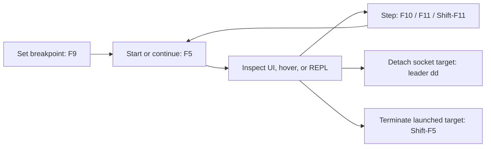

# Python debugging with DAP

Use this guide to launch or attach to Python from Neovim.
The setup uses `nvim-dap`, `nvim-dap-python`, `nvim-dap-ui`, and Mason
`debugpy-adapter`.

## Before the first session

Requirements:

- Open a Python buffer from the project root.
- Install Mason `debugpy` with `:MasonToolsInstall` if missing.
- Keep project launch settings in `.vscode/launch.json`.
- Use standard JSON without trailing commas.
- Keep `.env` local. Never copy secrets into dotfiles.

The Python pack and local DAP spec configure the Mason adapter.
If `debugpy-adapter` is missing from `$PATH`, setup stops with this error:

```text
Python DAP is unavailable: Mason executable debugpy-adapter was not found. Run :MasonToolsInstall.
```

There is no system-Python fallback.
Project `.vscode/launch.json` entries are loaded when a session starts.

## The normal keyboard loop

1. Put the cursor on the line to inspect and press `F9` (or `<Leader>db`) to
   toggle a breakpoint.
2. Press `F5` (or `<Leader>dc`) and choose a configuration. The chooser combines
   the built-in Python entries with entries from `.vscode/launch.json`.
3. When execution stops, inspect the DAP UI, hover, or REPL, then step with
   `F10`, `F11`, and `Shift-F11`.
4. Continue with `F5`. Press `Shift-F5` only when the launched target should
   be terminated.

| Built-in entry | Use |
| --- | --- |
| `file` | Run the current file |
| `file:args` | Prompt for an argument string and split it into arguments |
| `attach` | Prompt for host and port |
| `file:doctest` | Run doctests |

Use a project launch file for repeatable file, module, argument-list, or socket
settings.



## Keymap reference

The following mappings are available in a Python buffer or an active DAP
session. `<Leader>` is the configured global leader.

| Key | Action |
| --- | --- |
| `F5`, `<Leader>dc` | Start or continue, then choose a configuration when needed |
| `F9`, `<Leader>db` | Toggle a line breakpoint |
| `Shift-F9`, `<Leader>dC` | Prompt for a conditional breakpoint expression |
| `F10`, `<Leader>do` | Step over |
| `F11`, `<Leader>di` | Step into |
| `Shift-F11`, `<Leader>dO` | Step out |
| `F6`, `<Leader>dp` | Pause |
| `<Leader>ds` | Run to cursor |
| `Shift-F5`, `<Leader>dQ` | Terminate the session and its launched target |
| `Ctrl-F5`, `<Leader>dr` | Restart the current frame, not the whole process |
| `<Leader>dq` | Close the DAP session without an explicit terminate request |
| `<Leader>dd` | Detach and close the DAP session with `terminateDebuggee=false` |
| `<Leader>dl` | Add a logpoint; prompt for its message |
| `<Leader>dL` | Add a hit-condition breakpoint; prompt for its hit condition |
| `<Leader>dx` | Pick adapter-provided exception filters |
| `<Leader>dv` | List breakpoints and logpoints in the quickfix window |
| `<Leader>du` | Toggle the DAP UI |
| `<Leader>dh` | Hover the expression under the cursor |
| `<Leader>dE` | Prompt for an expression and evaluate it; in Visual mode evaluate the selection |
| `<Leader>dR` | Toggle the DAP REPL |
| `<Leader>dt` | Debug the nearest Python test method |
| `<Leader>dT` | Debug the nearest Python test class |

For `<Leader>dt` and `<Leader>dT`:

- Install the Python tree-sitter parser to locate the method/class.
- `nvim-dap-python` detects pytest from project configuration when possible.
  Otherwise it uses its fallback runner.
- If detection is wrong, set `require("dap-python").test_runner = "pytest"`
  in the project configuration.

### Breakpoint details

- A conditional breakpoint stops only when its expression is truthy.
- A logpoint logs its message and continues instead of stopping. `debugpy`
  supports `{name}`-style variable interpolation in the message.
- A hit condition is adapter-defined. For `debugpy`, enter the count as a
  string such as `3` to stop on the requested visit. Verify the behavior for
  non-numeric expressions in the target project before relying on them.
- The exception picker asks the adapter for available filters. With `debugpy`,
  the common filters are `raised` and `uncaught`; the active adapter remains
  the source of truth.

## File, module, and test launches

Create `.vscode/launch.json` in the project when built-in entries are insufficient.
`cwd` sets the project root; `envFile` points to a local-only `.env`.

```json
{
  "version": "0.2.0",
  "configurations": [
    {
      "name": "Python: current file",
      "type": "python",
      "request": "launch",
      "program": "${file}",
      "cwd": "${workspaceFolder}",
      "envFile": "${workspaceFolder}/.env",
      "justMyCode": true
    },
    {
      "name": "Python: module",
      "type": "python",
      "request": "launch",
      "module": "uvicorn",
      "args": ["app.main:app", "--reload"],
      "cwd": "${workspaceFolder}",
      "envFile": "${workspaceFolder}/.env",
      "justMyCode": true
    },
    {
      "name": "Python: attach localhost:5678",
      "type": "python",
      "request": "attach",
      "connect": { "host": "127.0.0.1", "port": 5678 },
      "justMyCode": true
    },
    {
      "name": "Python: attach container",
      "type": "python",
      "request": "attach",
      "connect": { "host": "127.0.0.1", "port": 5678 },
      "pathMappings": [
        { "localRoot": "${workspaceFolder}", "remoteRoot": "/app" }
      ],
      "justMyCode": true
    }
  ]
}
```

- `Python: current file` runs `${file}`.
- Replace the module example with your project's `module` and `args`.
- Use built-in `file:args` for one-off arguments.
- For pytest, place the cursor inside a method/class and press `<Leader>dt`
  or `<Leader>dT`. The launch uses its node path and `-s` for visible output.

## Socket attach with debugpy

Start the target listener before pressing `F5`. Run one of these commands
in the target project, with `debugpy` installed in its Python environment:

```sh
python3 -m debugpy --listen 127.0.0.1:5678 -m uvicorn app.main:app
python3 -m debugpy --listen 127.0.0.1:5678 --wait-for-client -m uvicorn app.main:app
```

The second command waits for Neovim before continuing.
Alternatively, start the listener in application code:

```python
import debugpy

debugpy.listen(("127.0.0.1", 5678))
debugpy.wait_for_client()
```

Choose `Python: attach localhost:5678` from the launch file.
For another address, choose built-in `attach`.
Its defaults are host `127.0.0.1` and port `5678`.

For a container or remote process:

1. Make the listener reachable through container publishing or SSH forwarding.
2. Match the attach port to the forwarded port.
3. Add `pathMappings` when local and remote paths differ.

Protect any listener bound to `0.0.0.0` with a trusted network boundary.
Never expose it to an untrusted network.

Example with a remote root of `/app`:

```json
{
  "name": "Python: attach container",
  "type": "python",
  "request": "attach",
  "connect": { "host": "127.0.0.1", "port": 5678 },
  "pathMappings": [
    { "localRoot": "${workspaceFolder}", "remoteRoot": "/app" }
  ]
}
```

| Goal | Command | Contract |
| --- | --- | --- |
| Leave a socket target running | `<Leader>dd` | Send `terminateDebuggee=false`, then close DAP |
| Stop a target launched by Neovim | `Shift-F5` / `<Leader>dQ` | Request termination |

Target behavior still depends on the adapter and transport.
Detach does not promise to restart or shut down the application.

### macOS PID limitation

Use an application-side `debugpy.listen(...)` socket on macOS.
Arbitrary PID injection is outside this configuration's supported workflow.

`debugpy --pid <PID>` may be blocked by macOS task-port permissions.
It is not a fallback or readiness check for socket attach.
PyCharm process/interpreter integration does not change this limitation.

## Inspecting state and recovering

- **No adapter:** run `:MasonToolsInstall`, verify the Mason
  `debugpy-adapter` executable is available, and restart Neovim if the plugin
  was installed during this session. No system-`python` fallback is attempted.
- **No configuration appears:** check that Neovim's working directory is the
  project root, that the file is Python, and that `.vscode/launch.json` is valid
  standard JSON with `version` and `configurations`.
- **The test method/class is not found:** install/enable the Python tree-sitter
  parser, place the cursor inside the test, and confirm the project runner is
  detected as pytest.
- **Socket attach refuses the connection:** start the target listener first;
  verify host, port, container port publishing/SSH forwarding, and firewall
  rules. For remote paths, add `pathMappings` and use absolute remote roots.
- **The UI is missing:** toggle `<Leader>du`; use `<Leader>dh`, `<Leader>dE`,
  or `<Leader>dR` for focused inspection. `dapui` opens automatically when a
  session initializes when its plugin is available.
- **A stale or broken session remains:** use `<Leader>dq` to close the client,
  or `<Leader>dQ` to terminate a launched target, then start again with `F5`.
  Use `<Leader>dd` for a socket target that must stay alive.

## PyCharm parity and intentional gaps

The table describes scope, not feature equivalence.

| Capability | Neovim in this setup | PyCharm comparison |
| --- | --- | --- |
| File/module launch and arguments | Built-in chooser plus versioned `.vscode/launch.json` | Run/debug configurations with a richer GUI editor |
| Breakpoints | Line, conditional, logpoint, hit condition, list/quickfix | Comparable core breakpoint types with more inline controls |
| Exceptions | Adapter-provided filter picker | GUI exception breakpoint editor and broader IDE presentation |
| Tests | Nearest method/class via `nvim-dap-python` and pytest node paths | Richer test tree, gutter actions, parametrization and test navigation |
| Variables and evaluation | DAP UI, hover, REPL, expression evaluation | More integrated inspectors, watches and data presentation |
| Socket/container attach | Explicit debugpy listener, host/port, and manual path mappings | More integrated interpreter, remote target and mapping workflows |
| Arbitrary macOS PID injection | Not supported; use socket attach | PyCharm has process/interpreter integrations outside this contract |
| Data/scientific debugging | Not included | PyCharm has richer DataFrame/scientific views |
| Smart Step Into and test-runner UX | Not included; use ordinary stepping and DAP test commands | Available as IDE-oriented features |

## Verification limits

The original implementation recorded checks for:

- Mason adapter availability, using `debugpy 1.8.21` at the time;
- a loopback attach, breakpoint stop, and detach that left the target running;
- project launch-file discovery through a deterministic headless chooser check.

These are historical results. Recheck the adapter after environment changes.
They do not establish interactive UI, logpoint, pytest, expression evaluation,
or arbitrary PID-injection behavior.
